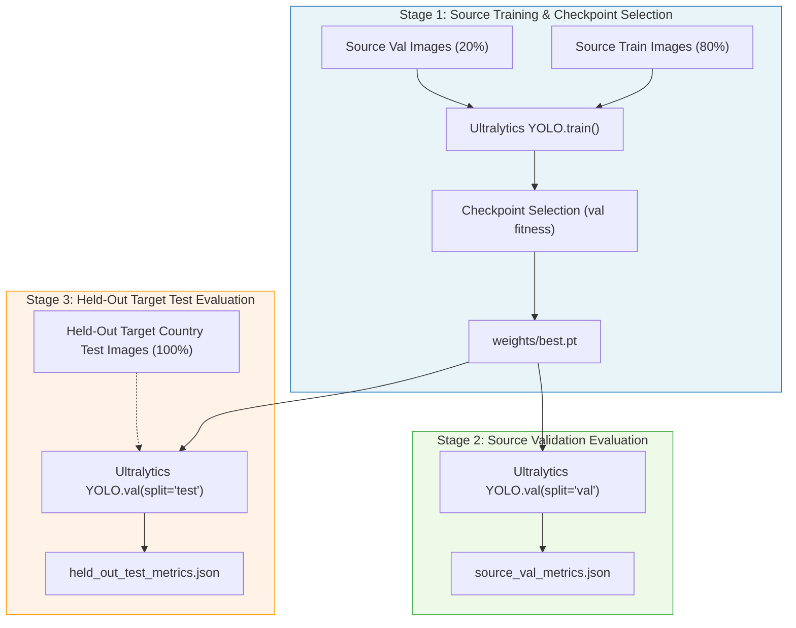

# YOLOv8s LOCO Baseline Training & Evaluation Guide

This document details the standardized hyperparameter configuration, three-stage training/evaluation methodology, hardware optimization for Google Colab Pro (NVIDIA L4 GPU), and execution procedures for the Six-Country Leave-One-Country-Out (LOCO) YOLOv8s source-only baseline.

---

## 1. Scientific Protocol & Methodology

The primary goal of the source-only baseline is to measure standard YOLOv8s cross-country transfer performance across six sovereign countries (`China`, `Czech`, `India`, `Japan`, `Norway`, `United_States`) prior to applying the CCARC reliability-consistency framework.

### Three-Stage Isolation Protocol



1. **Stage 1 (Source Training)**:
   - Trained exclusively on source-country training partitions ($\approx 80\%$ of source data).
   - Validated on source-country validation partitions ($\approx 20\%$ of source data) at the conclusion of every epoch.
   - The checkpoint `best.pt` is selected **purely on source validation fitness**:
     $$\text{Fitness} = 0.1 \times \text{mAP@0.5} + 0.9 \times \text{mAP@0.5:0.95}$$
   - **Target-Data Isolation**: The held-out target country partition (`test`) is **strictly isolated** and never read, exposed, or used during training, hyperparameter tuning, or early stopping.
2. **Stage 2 (Source Validation Evaluation)**:
   - Evaluates `best.pt` on the source validation split to benchmark in-domain generalization.
   - Records precision, recall, mAP@0.5, mAP@0.5:0.95, and per-class APs in `source_val_metrics.json`.
3. **Stage 3 (Held-Out Target Test Evaluation)**:
   - Evaluates `best.pt` on the unseen held-out target country (`test` split) to measure zero-shot cross-country transfer.
   - Records transfer metrics in `held_out_test_metrics.json`.

---

## 2. Standardized Baseline Hyperparameter Configuration

All six LOCO folds share an identical training configuration defined in [`src/training/baseline_config.py`](file:///d:/Projects%20I%20do/CCARC-Road-Damage-Research/src/training/baseline_config.py):

| Parameter | Value | Rationale |
| :--- | :---: | :--- |
| **Model Architecture** | `yolov8s.pt` | Small variant balancing cross-country feature richness and compute efficiency. |
| **Pretrained Weights** | COCO Pretrained | Standard transfer learning initialization. |
| **Target Classes** | 4 | `D00` (Longitudinal), `D10` (Transverse), `D20` (Alligator), `D40` (Pothole). |
| **Input Resolution** | `640 x 640` | Standard YOLOv8 detection scale. |
| **Batch Size** | `16` | Optimal for NVIDIA L4 (24GB VRAM) and stable gradient estimation. |
| **Epochs** | `100` | Sufficient convergence window with early stopping. |
| **Patience** | `20` | Early stopping triggered if source validation fitness does not improve for 20 epochs. |
| **Optimizer** | `SGD` | Explicit SGD optimizer with momentum `0.937`, weight decay `0.0005`. |
| **Learning Rate** | $\text{lr}_0 = 0.01, \text{lrf} = 0.01$ | Cosine decay schedule down to $1\%$ of initial learning rate. |
| **Warmup** | `3.0 epochs` | Linear warmup of bias learning rate (`0.1`) and momentum (`0.8`). |
| **Random Seed** | `42` | Enforces deterministic sample shuffling and augmentation sequences. |
| **Mixed Precision (AMP)** | `True` | Accelerates Tensor Core execution on NVIDIA Ada Lovelace / L4 hardware. |
| **Mosaic Augmentation** | `1.0` (Prob: 100%) | Standard multiscale context augmentation for road surface imagery. |
| **Flip Augmentation** | $\text{fliplr} = 0.5, \text{flipud} = 0.0$ | Horizontal flips only; vertical flips disabled to preserve driving perspective. |

> [!NOTE]
> **Baseline Augmentation vs. Future Research Scope**: The augmentations above represent the standard, frozen Ultralytics YOLO baseline. They intentionally exclude future CCARC road-specific consistency methods (such as road-weather style transfer, camera perspective invariance, and consistency regularization) so that future performance gains can be rigorously attributed to CCARC contributions.

> [!WARNING]
> **Methodological Evaluation Limitation (Target-Positive Only)**:
> In accordance with the conservative dataset cleaning policy, the held-out test evaluation is performed strictly on verified annotated damage images (`converted_target`). Consequently, cross-country test metrics reflect recall and localization quality on damage-positive scenes, but do not assess false-positive rates on unannotated road imagery or non-damage road textures.

---

## 3. Storage Separation & Checkpoint Persistence

To optimize I/O speed and guard against Google Colab disconnection:

1. **Local High-Speed Training (`--local-run-dir`)**:
   - Model training, batch loading, and intermediate metric generation occur on Colab's local high-speed NVMe/SSD at `/content/runs/yolov8s_baseline`.
2. **Real-Time Google Drive Checkpoint Synchronization**:
   - At the conclusion of every epoch (`on_fit_epoch_end`), `weights/last.pt`, `weights/best.pt`, and `results.csv` are automatically mirrored to persistent Google Drive storage (`--output-dir`).
3. **Safe Resumption**:
   - If a runtime preempts, passing `--resume` restores the latest checkpoint from Google Drive into the local directory and resumes training seamlessly without loss of progress.

---

## 4. Persistent Artifact Hierarchy

Experiment outputs are saved directly to persistent Google Drive storage:

```text
/content/drive/MyDrive/.../experiments/yolov8s_baseline/
├── six_fold_baseline_summary.json       # Compiled benchmark results across all 6 folds
├── fold_0_China/
│   ├── config_snapshot.yaml             # Exact hyperparameters and package versions
│   ├── reproducibility_metadata.json    # Machine, software, optimizer, and seed metadata
│   ├── dry_run_report.json              # Path validation & GPU check output
│   ├── train_stage_summary.json         # Training duration and epoch completion status
│   ├── source_val_metrics.json          # Stage 2 source validation metrics
│   ├── held_out_test_metrics.json       # Stage 3 held-out target evaluation metrics (if requested)
│   ├── fold_master_summary.json         # End-to-end fold summary
│   ├── results.csv                      # Epoch-by-epoch loss and validation metrics
│   ├── results.png                      # Training curves (loss, mAP, precision, recall)
│   └── weights/
│       ├── best.pt                      # Model weights with highest source validation fitness
│       └── last.pt                      # Checkpoint from final epoch (supports safe resumption)
├── fold_1_Czech/
├── fold_2_India/
├── fold_3_Japan/
├── fold_4_Norway/
└── fold_5_United_States/
```

---

## 5. Google Colab Pro Execution Instructions (NVIDIA L4)

### Cell 1: Mount Google Drive
```python
from google.colab import drive
drive.mount('/content/drive')
```

### Cell 2: Navigate to Project Repository & Pull Updates
```bash
%cd /content/CCARC-Road-Damage-Research
!git pull origin main
```

### Cell 3: Verify Hardware & Run Test Suite
```bash
!pytest -v
```

### Cell 4: Execute Dry Run Validation (Fold 0 — China)
Validates dataset views, `data.yaml`, CUDA device detection, and output directories without starting GPU training or downloading weights:
```bash
!python -m src.training.train_loco_baseline \
  --views-dir "/content/datasets/loco_views" \
  --output-dir "/content/drive/MyDrive/CCARC-Road-Damage-Research/experiments/yolov8s_baseline" \
  --local-run-dir "/content/runs/yolov8s_baseline" \
  --fold 0 \
  --dry-run
```

### Cell 5: Train Single Fold (Stage 1 + Stage 2 Source Validation)
Trains exclusively on source data and evaluates source validation generalization. Target test data remains unexposed.
```bash
!python -m src.training.train_loco_baseline \
  --views-dir "/content/datasets/loco_views" \
  --output-dir "/content/drive/MyDrive/CCARC-Road-Damage-Research/experiments/yolov8s_baseline" \
  --local-run-dir "/content/runs/yolov8s_baseline" \
  --fold 0 \
  --epochs 100 \
  --batch-size 16 \
  --optimizer SGD \
  --device 0
```

### Cell 6: Explicitly Evaluate Held-Out Target Test (Stage 3)
Once Stage 1 and Stage 2 are complete, evaluate cross-country transfer on the held-out country:
```bash
!python -m src.training.train_loco_baseline \
  --views-dir "/content/datasets/loco_views" \
  --output-dir "/content/drive/MyDrive/CCARC-Road-Damage-Research/experiments/yolov8s_baseline" \
  --fold 0 \
  --eval-only \
  --eval-target \
  --device 0
```

### Cell 7: End-to-End Sequential Six-Fold Benchmark Execution
Executes Stage 1, Stage 2, and Stage 3 sequentially across all six countries:
```bash
!python -m src.training.train_loco_baseline \
  --views-dir "/content/datasets/loco_views" \
  --output-dir "/content/drive/MyDrive/CCARC-Road-Damage-Research/experiments/yolov8s_baseline" \
  --local-run-dir "/content/runs/yolov8s_baseline" \
  --all-folds \
  --all-stages \
  --epochs 100 \
  --batch-size 16 \
  --optimizer SGD \
  --device 0
```

### Cell 8: Resume Interrupted Training
If a Colab session disconnects or reaches runtime limits, rerun with `--resume` to continue training safely from `weights/last.pt` synced to Google Drive:
```bash
!python -m src.training.train_loco_baseline \
  --views-dir "/content/datasets/loco_views" \
  --output-dir "/content/drive/MyDrive/CCARC-Road-Damage-Research/experiments/yolov8s_baseline" \
  --local-run-dir "/content/runs/yolov8s_baseline" \
  --fold 0 \
  --resume \
  --device 0
```

### Cell 9: Inspect Benchmark Performance Table
```python
import json
import pandas as pd
from pathlib import Path

summary_path = Path("/content/drive/MyDrive/CCARC-Road-Damage-Research/experiments/yolov8s_baseline/six_fold_baseline_summary.json")
if summary_path.is_file():
    with open(summary_path, "r", encoding="utf-8") as f:
        data = json.load(f)
    df = pd.DataFrame(data["folds"])
    display(df)
else:
    print("Benchmark summary not found yet:", summary_path)
```
